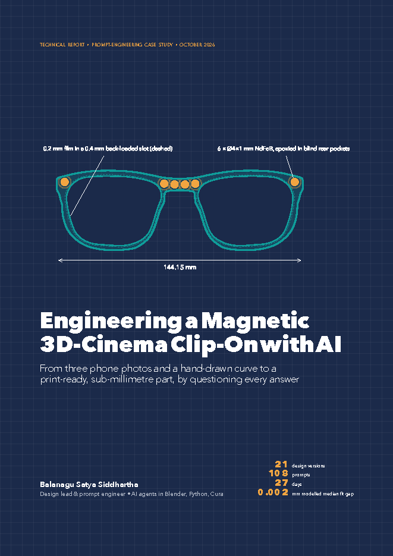
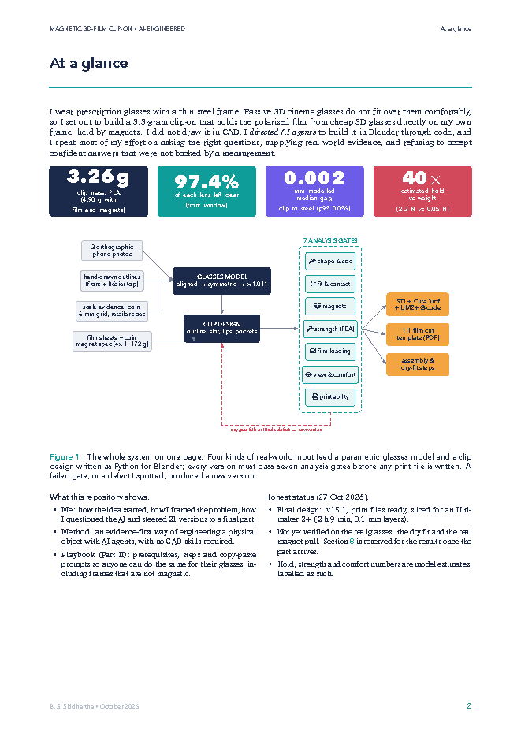
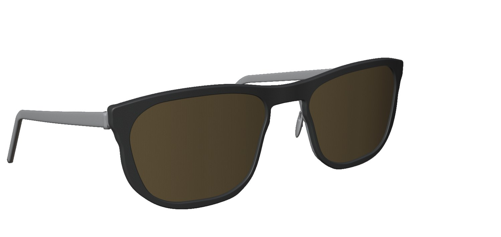
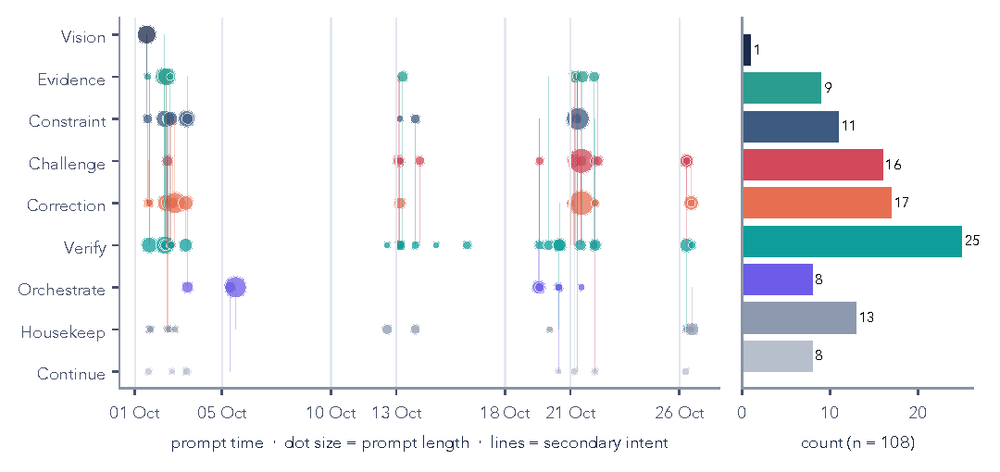
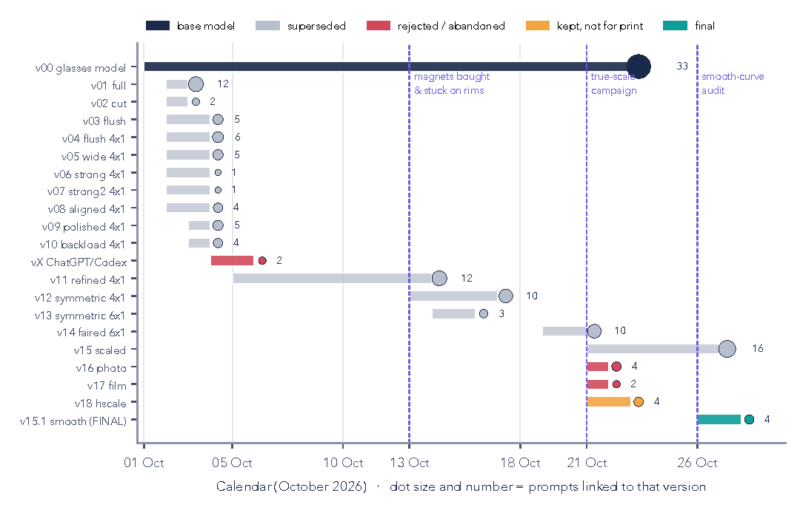
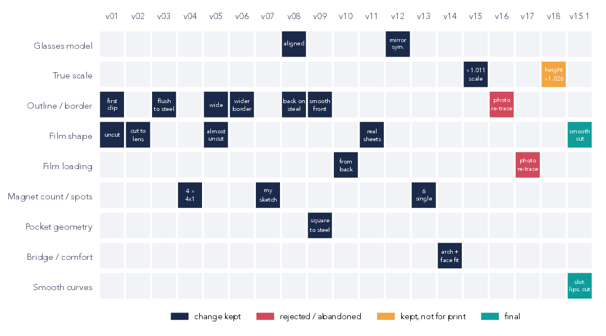
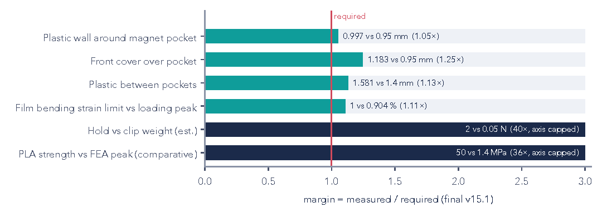
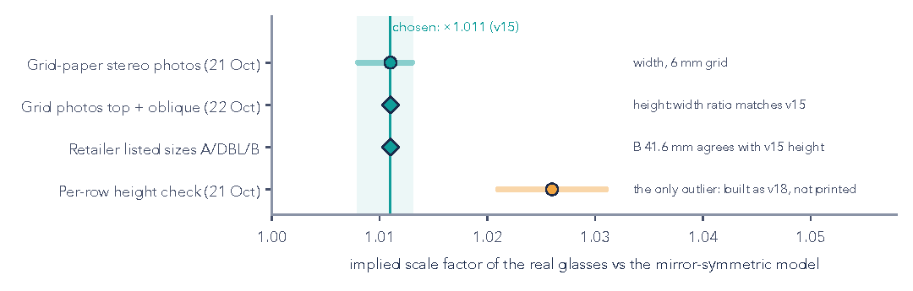

# AI-engineered magnetic 3D-cinema clip-on

**A 3.3 g clip-on that snaps polarised 3D-cinema film onto my own prescription glasses with six hidden magnets. I designed it without CAD by directing AI agents in Blender, and the work that mattered most was questioning them.**

<p align="center">  </p>

📄 **Full report (23 pages, LaTeX):** [`report/AI_Engineered_3D_Clipon_Report.pdf`](report/AI_Engineered_3D_Clipon_Report.pdf)

| 21 | 108 | 27 days | 0.002 mm | 97.4 % |
|:-:|:-:|:-:|:-:|:-:|
| design versions | prompts | 1–27 Oct 2026 | modelled median gap, clip to steel | of each lens left clear |

---

## Why this repo exists

1. **To show how I think and work with AI.** It covers where the idea came from, how I framed the problem, how I questioned every confident answer, and how I ran several AI models as one engineering team.
2. **To help others do the same** (optional). Part II of the report and the `guide/` and `prompts/` folders are a playbook for building one for your own glasses, including frames that are **not** magnetic.

## The story in 60 seconds

- **Problem.** Cinema 3D glasses worn over prescription glasses slide, press on the nose and tilt the film. Generic clip-ons cover part of the view.
- **First attempt (no AI).** I cut the film out of cinema glasses and glued Coke-can aluminium hooks to it. The super glue fogged the film. That failure gave me the three rules for the whole project: no CA glue near the film, the film must stay flat (it may bow one way, never dome), and the attachment must be repeatable.
- **Idea.** My frame is steel, so the frame itself can be the fixture. A thin printed carrier holds the film, and tiny magnets hidden in its back snap onto the rims.
- **Method.** One main AI model writes Blender/Python and keeps the context. Other models do reviews and bounded jobs. Every version must pass seven analysis gates before a print file exists.
- **Result.** v15.1 is 144 mm wide, 3.26 g PLA, with six Ø4×1 mm magnets. The film loads from the back. The part is print-ready and sliced. **The dry fit on the real glasses is still pending**, and Section 8 of the report is reserved for those results.

## How I questioned the AI

<p align="center"></p>

Only one of my 108 prompts stated the goal. **58 (54 %) were about checking, not building**: 25 asked for verification, 17 corrected a specific defect (often with my own markup on a screenshot) and 16 challenged a claim. A few examples:

> *"why this gap? any reasoning ? you kept it even tho you know thats visible from your analysis ?"* (the clip back was rebuilt from the true steel surface; final median gap is 0.002 mm)

> *"the magnet hol is like slanty cylinder i dont think whats how a magnet hole should be ??"* (the pockets were made square to the steel and blind from the front)

> *"are you sure? … the magnets i bought felt not that strong"* + the manufacturer's note that rated pull assumes 10 mm horizontal steel (I rebuilt the hold model, stuck 20 magnets on my real rims to test, and moved to six magnets)

> *"i only have one shot to print … i want this precision 2.345mm kindof"* (a true-scale campaign with grid paper, a coin and retailer sizes; 3 of 4 sources agree on ×1.011)

> *"now the user (me) should suffer cutting the film in this complex shape"* (the photo-trace wiggles were removed; every hand-cut line is now a smooth curve)

Every prompt I typed, lightly curated: [`prompts/original_prompts.md`](prompts/original_prompts.md).

## The journey

<p align="center"></p>

<p align="center"><br><sub>What changed in each version and why. From the front the versions look almost identical; the engineering happened in tenths of a millimetre.</sub></p>

## Evidence, not confidence

<p align="center"></p>
<p align="center"></p>

## Build one for your glasses

| | |
|---|---|
| **Steel frame** (a fridge magnet sticks) | Follow Part II of the report: prerequisites, the 10-step procedure and the prompt pack. |
| **Plastic / titanium / rimless** | Use a clamp that grips the frame from all sides (top hooks + bottom lips + side tabs). See [`guide/NON_METAL_FRAMES.md`](guide/NON_METAL_FRAMES.md). |
| **Copy-paste prompts** | [`prompts/PROMPT_PLAYBOOK.md`](prompts/PROMPT_PLAYBOOK.md) |
| **Example files** | [`files/`](files/): my final clip as a light STL and my 1:1 film template. They fit **my** glasses only and are for reference, not for printing on yours. |

**Prerequisites in short:** your glasses, a pair of passive (polarised) cinema 3D glasses, a phone camera, grid paper and a coin, Blender plus an AI coding agent that can run it, access to a 3D printer (0.1 mm layers), calipers or a ruler, and 2-part epoxy (never super glue). For the magnetic route you also need about 10 Ø4×1 mm N52 discs.

**Safety:** never use super glue near the film, because its fumes fog it. Never walk around or drive wearing 3D film. Stop if the clip presses on your nose or cheeks.

## Repository map

```
report/    LaTeX source (main.tex), charts/, figures/, and the compiled PDF
guide/     NON_METAL_FRAMES.md: the clamp route for non-magnetic frames
prompts/   PROMPT_PLAYBOOK.md (templates) and original_prompts.md (my real prompts)
files/     example STL and film template from my build (reference only)
scripts/   curate_prompts.py, collect_figures.py, make_charts.py and the gates for delegated work
docs/img/  images for this README
```

Build the report: `make -C report` (XeLaTeX; it uses the macOS fonts Charter, Avenir Next and Menlo).

## Status

- ✅ Design final (v15.1) and sliced for an Ultimaker 2+ (2 h 9 min, PLA, 0.1 mm layers)
- ⏳ Printing, then the dry fit, measured magnet pull and the first movie night. The report will be updated when the part arrives.

---
*Balanagu Satya Siddhartha, October 2026. Design workspace (Blender scenes, every version, all analyses) kept private; this repo carries the story, method and playbook.*
